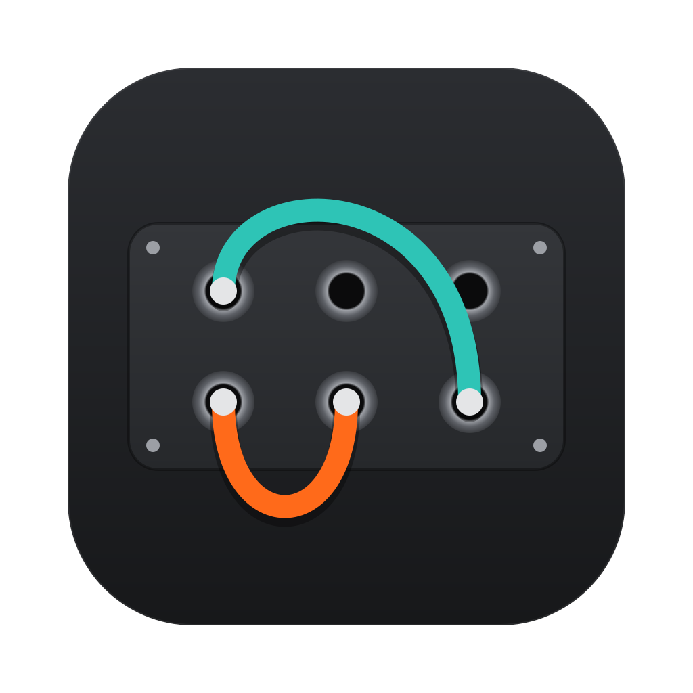
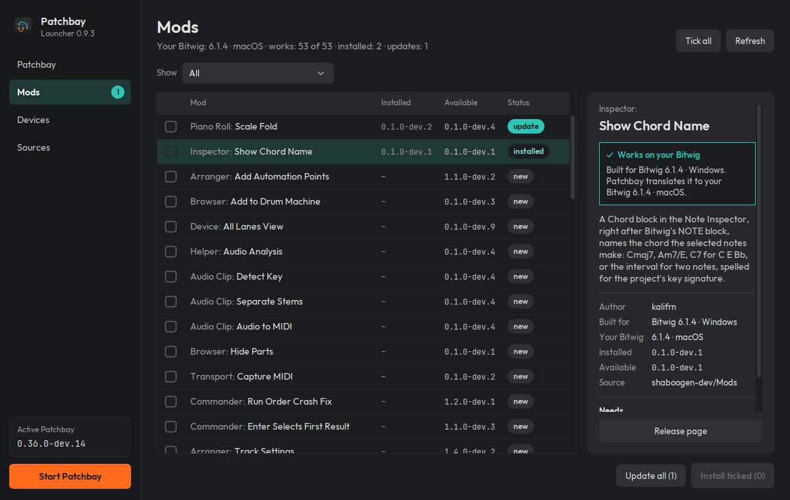
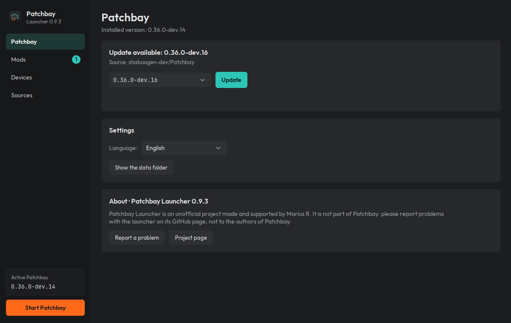
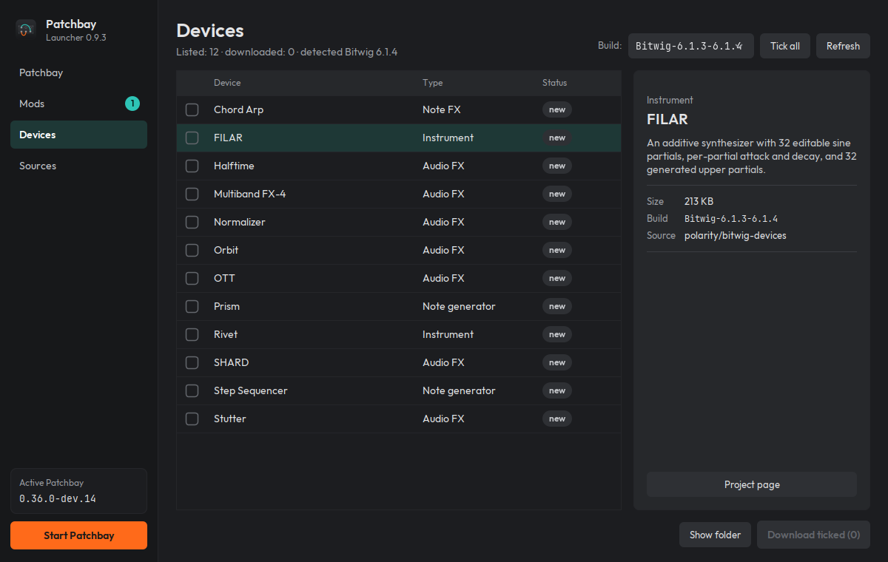
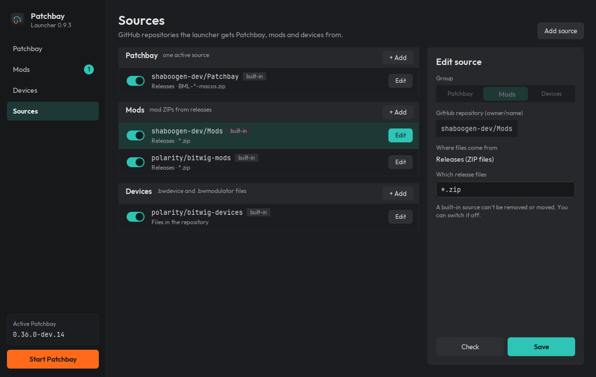

<p align="center"></p>

# Patchbay Launcher

A small desktop app for macOS, Windows and Linux that installs, updates and starts [Patchbay](https://github.com/shaboogen-dev/Patchbay), the mod loader for Bitwig Studio, without Terminal or a console window. It also downloads and updates mods and devices from GitHub.

> **Unofficial, made and supported by [Marius R (arius77R)](https://github.com/arius77R).** Patchbay Launcher is a separate project from Patchbay: it is not made by the authors of Patchbay, the mods or the devices it downloads, nor by Bitwig GmbH. **Questions and problems with the launcher go to this repository's [Issues](../../issues)**, not to Patchbay. Bitwig and Bitwig Studio are trademarks of Bitwig GmbH.
>
> **Beta.** Patchbay itself is not at 1.0 yet and some of what the launcher relies on (release file names, the mods folder layout) may still change. The launcher will follow those changes.

<p align="center"></p>

## Download

Get the latest version from [Releases](../../releases):

| System | File | First start |
|---|---|---|
| macOS (tested on macOS 26 Tahoe, Intel) | `Patchbay-Launcher-<version>-macos.dmg` | Drag the app to Applications. If macOS blocks it, open **System Settings → Privacy & Security** and click **Open Anyway**. |
| Windows 10 / 11, 64-bit (tested on Windows 10) | `Patchbay-Launcher-<version>-windows.zip` | Unzip, open the `Patchbay Launcher` folder and start `Patchbay Launcher.exe`. If SmartScreen appears, click **More info → Run anyway**. |
| Linux x64 (**beta, testers wanted**) | `Patchbay-Launcher-<version>-linux.tar.gz` | `tar -xzf` it, then run `Patchbay-Launcher/patchbay-launcher`. The launcher offers to add itself to the applications menu. Needs Bitwig from bitwig.com (`/opt/bitwig-studio`); with Bitwig from Flathub, install a Java 21 runtime (not "headless"). |

The app is not signed (no Apple Developer ID, no Windows code-signing certificate), which is why the system asks once.

**Requirement:** Bitwig Studio must be installed. The launcher runs on the Java that comes with Bitwig, so nothing else is needed.

## What it does

- **Patchbay:** lists Patchbay releases, downloads and unpacks the one for your system, carries your mods and themes over to the new version, keeps the previous version, and starts Patchbay. It notifies you when a new version is out.
- **Mods:** a catalogue from the mod repositories with checkboxes, "Select all", "Update all" and details. It checks each mod against your Bitwig the way Patchbay does (with the map packs in the installed Patchbay), shows which mods won't run on your Bitwig and why, and lets you show only the ones that work. Mods are installed the same way as Patchbay's own **Add Mod…**, with a SHA-256 check and their required mods.
- **Devices:** `.bwdevice`, `.bwmodulator` and `.bwmodule` files, picked for your Bitwig version, checked against GitHub and added to Patchbay's Device Folders.
- **Sources:** built-in and your own GitHub repositories for Patchbay, mods and devices; switch them on and off, add, edit, remove.
- **Languages:** English, Polski, Deutsch, Français. Other system languages use English.

| Patchbay | Devices | Sources |
|---|---|---|
|  |  |  |

Built-in sources: [shaboogen-dev/Patchbay](https://github.com/shaboogen-dev/Patchbay), [shaboogen-dev/Mods](https://github.com/shaboogen-dev/Mods), [polarity/bitwig-mods](https://github.com/polarity/bitwig-mods), [polarity/bitwig-devices](https://github.com/polarity/bitwig-devices).

GitHub allows 60 requests an hour without signing in; the launcher caches what it can.

## Where it keeps things

| | macOS | Windows | Linux |
|---|---|---|---|
| Patchbay versions, devices, cache, settings | `~/Library/Application Support/PatchbayLauncher/` | `%LOCALAPPDATA%\PatchbayLauncher\` | `~/.local/share/PatchbayLauncher/` |
| Patchbay's own settings (read and updated) | `~/Library/Application Support/BML/` | `%LOCALAPPDATA%\BML\` | `~/.config/bml/` |

## Building

Requires JDK 21. MinGW-w64 (`x86_64-w64-mingw32-gcc`) is optional, for the Windows `.exe`.

```sh
./build.sh                    # build/launcher.jar, macOS .zip, Linux .tar.gz, Windows .zip
macos/build-dmg.command       # on a Mac, after build.sh: build/…-macos.dmg
```

| Folder | Contents |
|---|---|
| `src/` | The app (Java Swing, only `java.base` and `java.desktop`). `Platform.java` holds everything that differs between macOS and Windows. |
| `macos/app/` | The `.app` bundle without `launcher.jar`; its start script finds Java inside `Bitwig Studio.app`. |
| `macos/dmg/` | Disk image background and install note. |
| `linux/` | The Linux start script (finds Java the way Patchbay's `loader/platform.sh` does, Bitwig's own first) and its README. |
| `windows/` | `Patchbay Launcher.exe` source (C): finds `javaw.exe` from Bitwig the way Patchbay's `find-java.cmd` does, then starts `app\launcher.jar` without a console. |
| `icon/` | The app icon (SVG). |
| `test/fixtures/` | Sample GitHub API responses for the offline self-test. |

Offline self-test (also needs a Patchbay release ZIP and a few mod ZIPs in the fixtures folder):

```sh
java -Dlauncher.data=<empty dir> -Dlauncher.bmlsettings=<empty dir> \
     -jar build/launcher.jar --selftest <BML zip> <version> test/fixtures
```

Add `-Dlauncher.os=mac`, `windows` or `linux` (with that system's Patchbay ZIP) to test each system's code paths on any system.

## License

[MIT](LICENSE)
